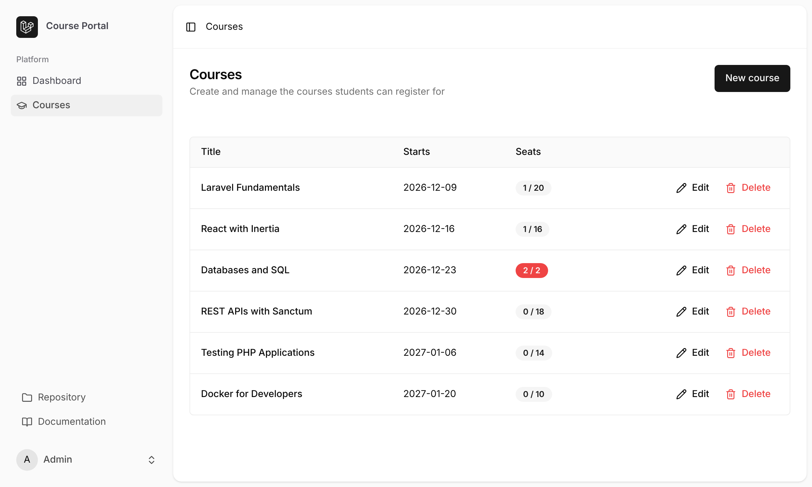
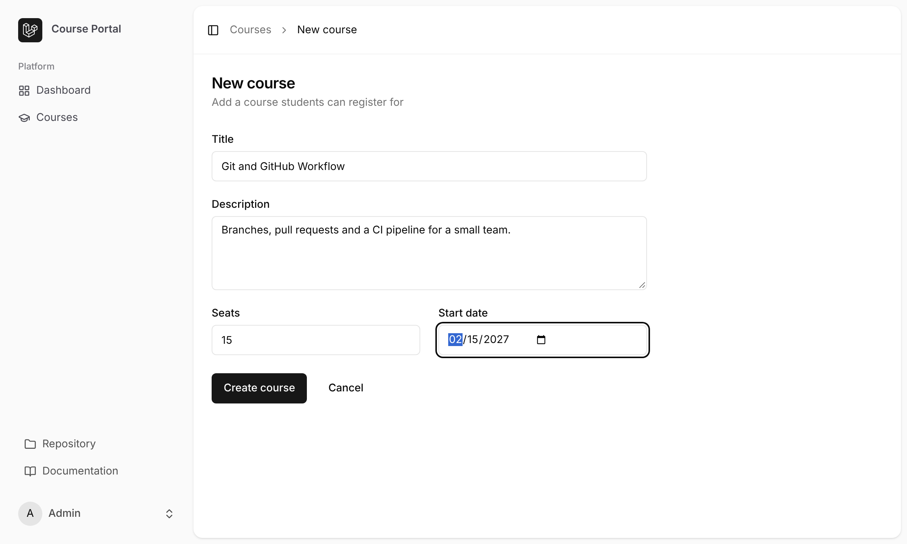
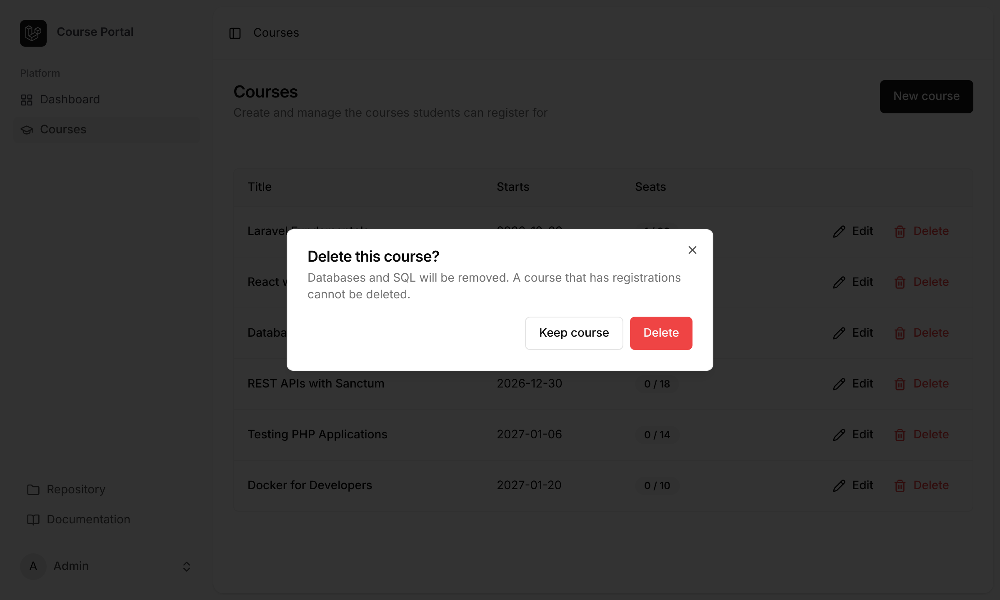
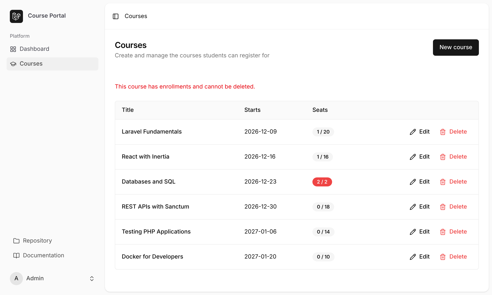
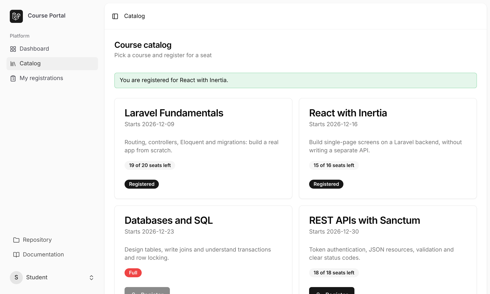
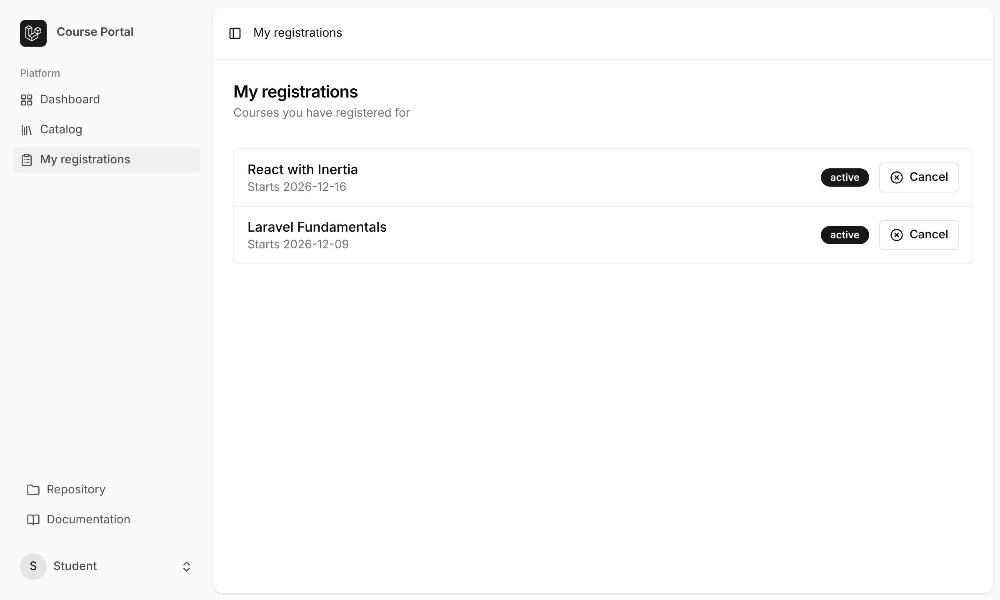
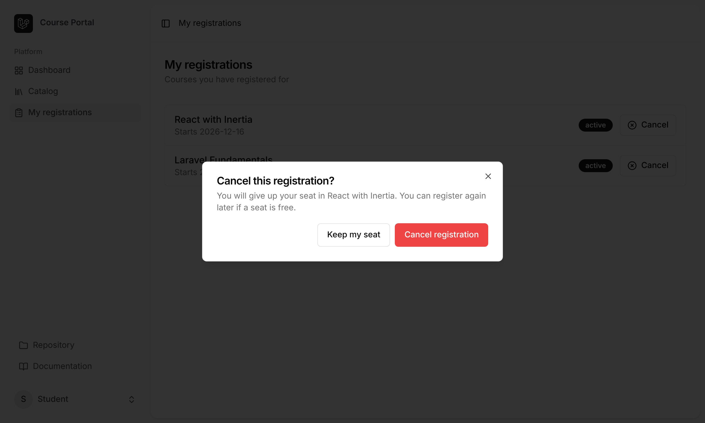
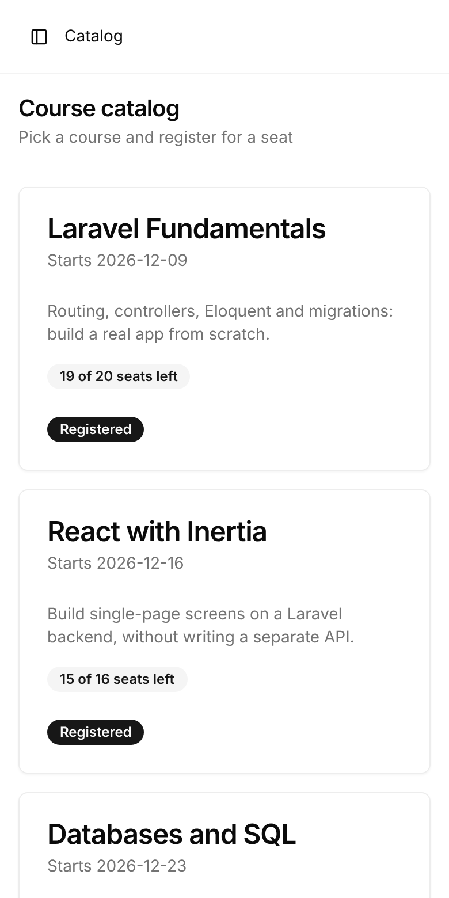
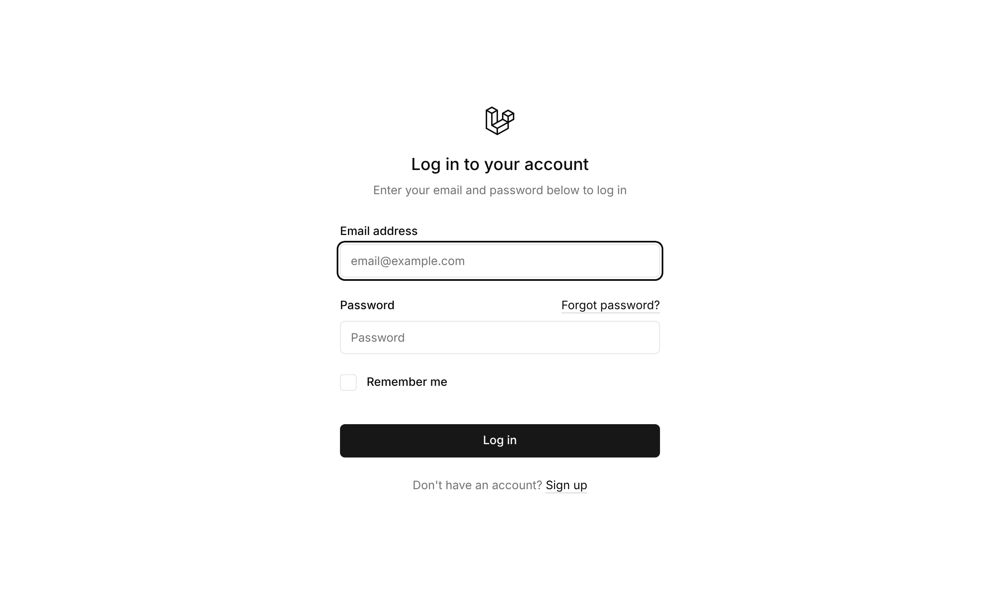

# Course Portal

A course registration portal for a training academy. Admins manage courses;
students browse them, register and cancel, subject to a seat limit. It has a
React web app and a token-secured REST API on the same Laravel backend.

**Stack:** Laravel 13, PHP 8.3, MySQL, Inertia, React, TypeScript, Tailwind,
shadcn/ui, Laravel Sanctum, Docker (Sail for development), GitHub Actions,
Sentry.

## Features

- Admin and student roles. Registration only ever creates students.
- Admins create, edit and delete courses (a course with registrations cannot be deleted).
- Students see seats left, register, and cancel behind a confirmation dialog.
- A course cannot be overbooked, even when students register at the same moment.
- A REST API with token login. See [docs/API.md](docs/API.md).

## Screenshots

Captured from the running app with the seeded demo data. The student is registered for Laravel Fundamentals and React with Inertia, and Databases and SQL has been filled by two other students, so every screen shows the same seat counts.

### Admin

| Course list | New course |
|---|---|
|  |  |

| Confirm before deleting | Databases and SQL has registrations, so it cannot be deleted |
|---|---|
|  |  |

### Student

| Course catalog | My registrations |
|---|---|
|  |  |

| Confirm before cancelling | On a phone |
|---|---|
|  |  |

### Sign in



## Getting started (Docker, recommended)

```bash
cp .env.example .env
composer install   # needs PHP 8.3+ and Composer on the host; Sail then runs the app
./vendor/bin/sail up -d
./vendor/bin/sail artisan key:generate
./vendor/bin/sail artisan migrate --seed
./vendor/bin/sail npm install
./vendor/bin/sail npm run dev
```

Seeded accounts (password `password`): `admin@example.com` (admin) and
`student@example.com` (student), plus 6 sample courses and one registration.

Without Docker, set `DB_CONNECTION=sqlite` in `.env`, run `composer install`,
`npm install`, `php artisan migrate --seed`, then `composer dev`.

## Tests

| What | Command |
|---|---|
| PHP tests (SQLite, no database needed) | `php artisan test` |
| Component tests (Vitest and Testing Library) | `npm test` |
| Lint, formatting and types | `npx eslint .`, `npm run format:check`, `npm run types` |
| PHP code style | `vendor/bin/pint --test` |

One test only runs on MySQL or MariaDB, because SQLite ignores row locks.
`EnrollmentConcurrencyTest` starts eight PHP processes that all try to take the
last seat at the same instant and expects exactly one winner. Run it with:

```bash
DB_CONNECTION=mysql DB_HOST=127.0.0.1 DB_DATABASE=testing DB_USERNAME=sail DB_PASSWORD=password php artisan test
```

## How it works

- **Seats left is calculated, not stored:** `seats` minus the active
  registrations. There is no second copy that can drift out of sync.
- **No overbooking:** `EnrollmentService::register()` locks the course row
  (`lockForUpdate`) inside a transaction, then counts seats. The second of two
  racing students sees the seat taken and gets a 409. Removing the lock makes
  the concurrency test fail.
- **Cancelling keeps the row:** it sets `status` to `cancelled`. Registering again
  reuses that row, because each student and course pair is unique in the database.
- **Authorization:** a `role:admin` or `role:student` middleware guards each
  route group, and `EnrollmentPolicy` makes sure only the owner cancels a registration.
- **Status codes:** 401 no token, 403 wrong role or not your record, 404 missing,
  409 full or duplicate, 422 invalid input.

## Deploying to Railway

The `Dockerfile` builds the assets, installs PHP dependencies without dev
packages and runs PHP 8.3 with nginx. `railway.toml` points Railway at it and
uses `/up` as the health check. Migrations run automatically on start.

1. Push this repo to GitHub and create a Railway project from it.
2. Add a **MySQL** service to the project.
3. On the web service, set these variables:

   | Variable | Value |
   |---|---|
   | `APP_KEY` | output of `php artisan key:generate --show` |
   | `APP_URL` | your Railway URL, for example `https://course-portal.up.railway.app` |
   | `APP_ENV` | `production` |
   | `APP_DEBUG` | `false` |
   | `DB_CONNECTION` | `mysql` |
   | `DB_HOST` | `${{MySQL.MYSQLHOST}}` |
   | `DB_PORT` | `${{MySQL.MYSQLPORT}}` |
   | `DB_DATABASE` | `${{MySQL.MYSQLDATABASE}}` |
   | `DB_USERNAME` | `${{MySQL.MYSQLUSER}}` |
   | `DB_PASSWORD` | `${{MySQL.MYSQLPASSWORD}}` |
   | `SESSION_DRIVER` / `CACHE_STORE` | `database` |
   | `PORT` | `8080` |
   | `SENTRY_LARAVEL_DSN` | your Sentry DSN (optional) |

4. Generate a public domain for the service.
5. Create the first admin from the service shell (`railway run` or the dashboard):

   ```bash
   php artisan admin:create you@example.com --name="Your Name"
   ```

   It prompts for the password. The demo seeder is disabled in production.

### Error monitoring

Set `SENTRY_LARAVEL_DSN` to turn Sentry on; leave it empty to keep it off.
After setting it, run `php artisan sentry:test` once to confirm an event arrives.

## User stories

1. As an **admin**, I can create, edit and delete courses, so the catalogue stays current.
2. As an **admin**, I can set a seat limit on each course, so classes are not overbooked.
3. As a **student**, I can browse courses and see how many seats are left, so I can choose one.
4. As a **student**, I can register for a course with free seats, so I secure my place.
5. As a **student**, I can cancel my registration and register again later, so I can change my mind.

## CI

GitHub Actions (`.github/workflows/ci.yml`) runs on every push and on
pull requests to `main`: PHP tests on SQLite with a Pint style check, the full PHP suite
against MySQL 8.4 (including the concurrency test), and the front-end lint,
format, type check and component tests.

## Project status

1. Setup, login, roles: done
2. Data model and admin course screens: done
3. Registration and cancellation: done
4. REST API with Sanctum: done
5. Tests and CI: done
6. Production setup: Dockerfile, Railway config, Sentry, API docs and this README are
   written. The Docker image has not been built and nothing is deployed yet.
